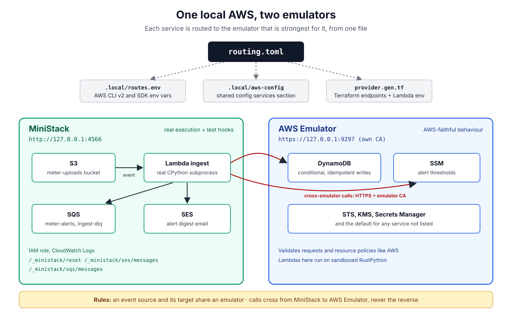
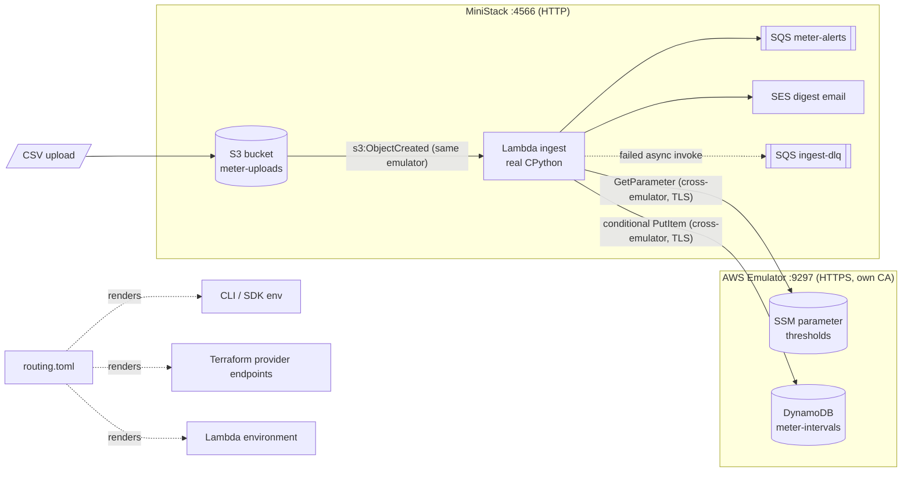

# split-brain-local-aws

[](https://github.com/ogasege/split-brain-local-aws/actions/workflows/local-aws.yml)

**Article:** [One Local AWS, Two Emulators: Routing Services Between AWS Emulator and MiniStack](https://builder.aws.com/content/3MWWzSRyKiPDDBmIwuhihQz2Vv7/one-local-aws-two-emulators-routing-services-between-aws-emulator-and-ministack) on AWS Builder Center.

Run **MiniStack** and **AWS Emulator** side by side as one local AWS, and send
each AWS service to the emulator that is strongest for it. One routing file
drives the AWS CLI, the SDKs, Terraform and the Lambda runtime, so they can
never disagree about where a service lives.

The sample app is an energy telemetry pipeline: solar inverter and grid meter
readings arrive as CSV, a Lambda turns cumulative kWh registers into interval
energy (handling counter rollovers and resets), writes idempotently to
DynamoDB and raises alerts. It runs end to end with no AWS account and no cost.

```
$ make up deploy verify test down
...
[ ok ] VERIFY PASS (16 checks, run r179546641321065)
```

Full output of a real run: [docs/verify-output.txt](docs/verify-output.txt).

## Architecture





Two rules shape the placement:

1. **An event source and its target must live in the same emulator.** AWS
   Emulator refuses an S3 notification to a Lambda it does not host. S3 and
   Lambda therefore sit together on MiniStack.
2. **Calls can cross from MiniStack to AWS Emulator, never the other way.**
   AWS Emulator runs Lambda code in a sealed in-process sandbox that can only
   reach its own services. MiniStack runs functions as normal processes that
   can call anything you route them to.

## Routing table

Source of truth: [`routing.toml`](routing.toml). Anything not listed falls
through to AWS Emulator, so a forgotten service can never reach real AWS.

| Service | Emulator | Why |
| --- | --- | --- |
| lambda | MiniStack | Runs handlers in real CPython with your real dependencies, and its functions can call out to AWS Emulator. AWS Emulator's sandboxed RustPython runtime cannot reach MiniStack. |
| s3 | MiniStack | The upload bucket fires the ingest Lambda, and the two must share an emulator. |
| sqs | MiniStack | Tests peek at alerts with `GET /_ministack/sqs/messages` without consuming them, and `POST /_ministack/reset` wipes everything. |
| ses | MiniStack | Tests read sent mail from `GET /_ministack/ses/messages`. AWS Emulator accepts `SendEmail` but gives no way to inspect what was sent. |
| iam | MiniStack | The execution role must exist where the function is created. |
| logs | MiniStack | Lambda log groups are written by the emulator that runs the function. |
| dynamodb | AWS Emulator | Idempotency depends on exact condition and validation semantics. AWS Emulator is built and scored against AWS behaviour. |
| ssm | AWS Emulator | Runtime thresholds live in Parameter Store with AWS-faithful errors. |
| sts | AWS Emulator | Identity calls answer from the emulator that holds the data plane. |
| kms, secretsmanager | AWS Emulator | Not used by the app; routed explicitly so encryption and secrets default to the fidelity-first emulator. |

Is the split worth it for *this* app? Honestly, the handler also runs entirely
inside AWS Emulator: I deployed the same zip to the emulator's own Lambda with
S3, DynamoDB, SSM and SQS all in the emulator, and it wrote the same 13 rows
and 3 alerts once the role had a policy. The split earns its keep when you
need what only one side has. MiniStack: test hooks (SES inbox, SQS peek, an
8 ms reset), functions that import native wheels such as numpy or pandas
(the emulator's RustPython runtime cannot load C extensions), functions that
must call both emulators, and Bedrock proxied to a local model. AWS Emulator:
AWS's exact validation behaviour, IAM evaluation for its own Lambdas' roles,
and real SQL for Athena (pip-installed MiniStack returns `SUCCEEDED` with mock
rows; only its DuckDB-enabled `:full` image runs queries).

A side-by-side probe of both tools (44 checks, same boto3 calls against each)
lives in [docs/compatibility/MATRIX.md](docs/compatibility/MATRIX.md) with
the harness to rerun it. Headline: AWS Emulator matched AWS on 42 of 44
checks, MiniStack on 33 of 44. On the DynamoDB checks this app depends on
(conditional put, `ReturnValuesOnConditionCheckFailure`, transaction
cancellation reasons) both behaved identically; the differences are on
validation paths, for example MiniStack accepting `UpdateExpression="SET = 1"`
or overlapping update paths that AWS rejects.

What this placement costs: S3 on MiniStack is looser than AWS. MiniStack
accepted a tampered presigned URL signature and a 1 KiB non-final multipart
part, both of which AWS Emulator rejects like AWS (presigned signatures only
with auth on: the `--auth off` instance `make up` starts accepts tampered and
expired URLs too). If this app handed presigned upload URLs to field devices,
I would test that path against a separate AWS Emulator started with auth on.

## Prerequisites

Tested versions (pin these):

| Tool | Version | Install |
| --- | --- | --- |
| AWS Emulator | 1.0.589 | Linux: `.deb` or `.rpm` from `https://downloads.aws.com/aws-emulator/packages/aws-emulator/LTS/latest/` (`aws-emulator_amd64.deb`, `aws-emulator-x86_64.rpm`). macOS/Windows: Docker, see [Compose mode](#compose-mode-macos-and-windows). |
| MiniStack | 1.5.44 | `pip install ministack==1.5.44` |
| AWS CLI | **v2** (tested 2.42.1) | CLI v1 is not supported, see [Troubleshooting](#troubleshooting) |
| Terraform | 1.17.2 (provider `hashicorp/aws` 6.73.0) | https://developer.hashicorp.com/terraform/install |
| Python | 3.11+ (3.12 recommended, it matches the Lambda runtime) | plus `pip install -r requirements-dev.txt` |
| curl, jq, make | any recent | |

The AWS Emulator download URL is `LTS/latest` and I found no version-pinned
URL, so CI logs the installed version and warns when it is not 1.0.589.

## Quickstart

On a stock Ubuntu 24.04 box (system Python is "externally managed", so use a venv):

```bash
sudo apt-get install -y make jq curl git python3-venv
# AWS Emulator (.deb shown; aws-emulator_arm64.deb and .rpm builds also exist, ~216 MB)
curl -fsSLo /tmp/aws-emulator.deb \
  https://downloads.aws.com/aws-emulator/packages/aws-emulator/LTS/latest/aws-emulator_amd64.deb
sudo apt-get install -y /tmp/aws-emulator.deb
# AWS CLI v2: https://docs.aws.amazon.com/cli/latest/userguide/getting-started-install.html
#   (not `pip install awscli`, which gives you v1)
# Terraform 1.17.2: https://developer.hashicorp.com/terraform/install

git clone https://github.com/ogasege/split-brain-local-aws.git && cd split-brain-local-aws
python3 -m venv .venv && . .venv/bin/activate     # keep it active for every make command
pip install -r requirements-dev.txt               # pins ministack==1.5.44, boto3, pytest

make up       # start AWS Emulator (:9297) and MiniStack (:4566), wait for health
make deploy   # terraform apply: 13 resources across both emulators
make verify   # upload a CSV, assert rows, alerts, email, idempotency
make test     # 20 unit tests + 16 integration tests
make down     # stop both (state is in memory and is gone)
```

To use the split stack from your own shell (after `make up`):

```bash
source scripts/env.sh
aws s3 ls                               # MiniStack
aws dynamodb list-tables                # AWS Emulator
aws sqs list-queues                     # MiniStack
python3 -c "import boto3; print(boto3.client('ssm').meta.endpoint_url)"   # https://127.0.0.1:9297
```

Other targets: `make routes` (re-render routing), `make destroy`
(terraform destroy), `make reset` (wipe both emulators between test runs, then
`make deploy`), `make clean`.

## How it works

### 1. One routing file, rendered three ways

`tools/render_routes.py` (stdlib only) turns `routing.toml` into:

| Output | Read by |
| --- | --- |
| `.local/routes.env` | AWS CLI v2 and every SDK: `AWS_ENDPOINT_URL` plus `AWS_ENDPOINT_URL_<SERVICE>` |
| `.local/aws-config` | the same routes as a shared-config `services` section (used as `AWS_CONFIG_FILE`) |
| `terraform/provider.gen.tf` | the AWS provider's `endpoints {}` block, plus `local.routing_env` injected into every Lambda |

Both SDK mechanisms (environment variables and the config-file `services`
section) behaved identically in AWS CLI 2.42.1 and boto3 1.43.124. I use
environment variables as the primary path because the exact same variables
can be injected into a Lambda's environment.

The environment variable suffix is the botocore service ID, upper-cased with
spaces turned into underscores. Watch the irregular ones:
`AWS_ENDPOINT_URL_CLOUDWATCH_LOGS` (not `_LOGS`),
`AWS_ENDPOINT_URL_SECRETS_MANAGER`, `AWS_ENDPOINT_URL_EVENTBRIDGE`. The
generator keeps that mapping in one table.

### 2. Credentials: AWS Emulator runs with `--auth off`

AWS Emulator normally accepts only its own `EMULATOR...` keys, regenerated on
every start. That works for the CLI and Terraform, and breaks the moment a
MiniStack-executed Lambda calls the emulator:

```
botocore.exceptions.ClientError: An error occurred (AccessDenied) when calling the GetParameter operation: Sign the request with the emulator credentials
```

MiniStack injects its own credentials into every function
(`AWS_ACCESS_KEY_ID=000000000000`) and drops `AWS_ACCESS_KEY_ID`,
`AWS_SECRET_ACCESS_KEY` and `AWS_SESSION_TOKEN` from the function's
environment as reserved names, exactly like real Lambda does. So the function
cannot present the emulator's key without local-only credential code in the
handler. I chose `--auth off` instead.

Tradeoffs, stated plainly:

* With auth off the emulator accepts unsigned or wrongly signed requests, so a
  broken signing setup is not caught locally.
* AWS Emulator *does* evaluate IAM identity policies for assumed-role
  credentials, for example its own Lambdas' execution roles (I saw
  `is not authorized to perform: s3:GetObject ... because no identity-based policy allows the s3:GetObject action`
  until I attached a policy). In this split the calls come from MiniStack,
  which does not evaluate IAM, and reach the emulator as an unauthenticated
  caller. **Nothing in the split stack tests your IAM policies.** Test them on
  a real sandbox account, or run the function inside AWS Emulator as a
  separate check. MiniStack also has an `AUTH=true` mode that enforces
  identity policies inside its Lambdas (measured in the compatibility probe);
  I have not run this split stack with it.
* Both emulators bind to 127.0.0.1 only.

Both then accept the same static keys (`test`/`test`). MiniStack maps a
non-numeric key to account `000000000000`, which is also AWS Emulator's only
account, so ARNs line up.

### 3. TLS: one CA, no combined bundle

AWS Emulator serves HTTPS with a CA it writes to
`~/.aws/emulator/9297/ca.pem` on every start. MiniStack is plain HTTP, so
`AWS_CA_BUNDLE=~/.aws/emulator/9297/ca.pem` is enough for both: it is only
consulted for HTTPS. Terraform gets the same file through
`custom_ca_bundle`. The Lambda needs it too (it is part of `routing_env`),
otherwise:

```
SSLError | SSL validation failed for https://127.0.0.1:9297/ [SSL: CERTIFICATE_VERIFY_FAILED] certificate verify failed: self-signed certificate (_ssl.c:1035)
```

The certificate is valid only for `localhost`, `127.0.0.1` and `::1`. Any
other hostname (`host.docker.internal`, a compose service name) fails
verification. `NO_PROXY` gets `localhost,127.0.0.1` prepended by
`scripts/env.sh` so a corporate proxy never sees local calls.

### 4. MiniStack starts with an empty environment

MiniStack's local Lambda executor builds each function's environment from
MiniStack's *own* process environment plus the function's variables. I
started it from my normal shell once and dumped a function's environment: it
had my shell's `AWS_SECRET_ACCESS_KEY` (matched by hash), `HTTPS_PROXY` and
`AWS_CA_BUNDLE`. `scripts/up.sh` therefore starts MiniStack under `env -i`
with an explicit list of variables, and the function's routing comes only
from its own configuration.

### 5. The Lambda is told where everything is

`terraform/main.tf` merges `local.routing_env` into the function's
environment. Without it, MiniStack points the function's SDK at MiniStack for
every service and the first sign of trouble is:

```
ResourceNotFoundException | An error occurred (ResourceNotFoundException) when calling the PutItem operation: Requested resource not found
```

The table exists, just in the other emulator. The first version of my handler
also fell back to default thresholds when the SSM parameter was missing, which
hid the wrong endpoint for one more step. It now fails fast instead.

On a real account, drop `routing_env` from the merge and the SDK uses normal
AWS endpoints. The handler has no local-only code.

### 6. Idempotency across emulators

S3 delivers events at least once and people re-upload files. Each interval is
written with `ConditionExpression="attribute_not_exists(pk) AND attribute_not_exists(sk)"`.
A replayed file produces `written: 0, duplicates: 13, alerts: 0`, and
`make verify` checks exactly that.

## Verify

`scripts/verify.sh` uses a fresh site-id prefix per run, so it never collides
with earlier runs, and checks:

* placement: the bucket exists in MiniStack and not in AWS Emulator, the table
  exists in AWS Emulator and not in MiniStack, the function carries the
  rendered routing
* 13 interval rows in DynamoDB, 3 alerts (GAP, RESET, SPIKE) on SQS, one
  digest email in SES
* exact values: a register rollover `99985.25 -> 2.75` stored as `17.49` kWh,
  a meter reset stored with no kWh
* replay: same readings under a new key, Lambda log shows 13 duplicates, rows,
  alerts and emails unchanged
* a malformed CSV becomes one `BAD_FILE` alert instead of a retry loop

Note: DynamoDB stores `17.490` as `17.49`. That is AWS behaviour (numbers are
normalised), and AWS Emulator reproduces it.

`tests/integration` adds: every route in `routing.toml` resolves in boto3,
an unrouted service falls back to the emulator, `ReturnValuesOnConditionCheckFailure`
returns the old item, and a cross-emulator S3 notification is refused.

## Teardown

```bash
make destroy   # terraform destroy across both emulators (12-13 resources)
make down      # stop both processes started by make up (tracked by pid file)
make clean     # also remove .local/, provider.gen.tf and .terraform/
```

`make down` removes the Terraform state file because both emulators keep
state in memory: after a stop the state would describe resources that no
longer exist.

## Compose mode (macOS and Windows)

AWS Emulator has no prebuilt image. `docker/aws-emulator/Dockerfile` is the
official recipe from the
[AWS Emulator User Guide](https://docs.aws.amazon.com/emulator/latest/userguide/getting-started-docker.html)
with the package architecture made a build argument.

```bash
mkdir -p ~/.aws/emulator
EMULATOR_ARCH=aarch64 SPLIT_BRAIN_MODE=compose make up   # x86_64 on Intel
SPLIT_BRAIN_MODE=compose make deploy verify
```

`docker-compose.yml` puts MiniStack in AWS Emulator's network namespace, so
the Lambda inside the MiniStack container reaches the emulator as
`127.0.0.1`, the only name its certificate accepts. It mounts
`~/.aws/emulator` at the same absolute path in both containers so the CA path
rendered into the Lambda environment resolves. On Windows, run from WSL2.

**Not verified in CI.** The repo was built and tested on Linux with native
binaries and no Docker daemon. `docker compose config` validates the file,
nothing more. The MiniStack container's Python and boto3 are what your
functions will run with in this mode.

## CI

[`.github/workflows/local-aws.yml`](.github/workflows/local-aws.yml) installs
the emulator `.deb` and `ministack` on `ubuntu-latest` and runs
`make up deploy verify integration`, then destroys and stops. Integration
tests on every pull request, no AWS account, no secrets, no cost. CI uses
Python 3.12 on purpose: MiniStack's local executor runs `python3.12`
functions with whatever interpreter MiniStack runs on.

## Troubleshooting

| Symptom | Cause | Fix |
| --- | --- | --- |
| `SSL validation failed for https://queue.amazonaws.com/` with routing exported | AWS CLI v1 forces legacy endpoints for SQS, RDS, EMR, DocumentDB, Neptune and Health, ignoring `AWS_ENDPOINT_URL_<SERVICE>` and config-file endpoints. The request goes to real AWS. | Use AWS CLI v2. `scripts/env.sh` refuses to load with v1. |
| `AccessDenied ... Sign the request with the emulator credentials` | AWS Emulator started with auth on | `make down up` (up.sh starts it with `--auth off`) |
| `ResourceNotFoundException` on PutItem from the Lambda | Function has no routing env, or AWS Emulator was restarted and lost its tables | `make deploy` (re-renders routing and recreates resources) |
| `SSLError ... self-signed certificate` | `AWS_CA_BUNDLE` not set, or the emulator restarted and rewrote `ca.pem` while a client held the old one | `source scripts/env.sh`; redeploy |
| `InvalidArgument ... Unable to validate the following destination configurations` | S3 notification target is in the other emulator, or lacks `lambda:AddPermission` | Keep source and target in one emulator; add `aws_lambda_permission` |
| `port 4566 is taken by something that is not a healthy MiniStack` | Another MiniStack or LocalStack | Stop it, or set `MINISTACK_PORT` and the endpoint in `routing.toml` |
| Lambda INFO logs missing in CloudWatch | Python's root logger has no handler outside real Lambda | Handler calls `logging.basicConfig()` when no handler exists |
| `terraform plan` keeps showing `maximum_event_age_in_seconds = 21600 -> null` | MiniStack reports 21600 when unset | Set it explicitly (done in `main.tf`) |
| Second MiniStack on the same machine fails to bind 8883 | IoT mTLS listener | `IOT_MTLS_ENABLED=0` (set by up.sh) |

## Limits

* **IAM is not tested by this setup.** See [Credentials](#2-credentials-aws-emulator-runs-with---auth-off).
* **Runtime fidelity of MiniStack's local executor:** functions run on the
  host interpreter (a `python3.12` function ran on Python 3.13 here) and can
  import packages from the host that are not in your zip, so a missing
  dependency is not caught. `LAMBDA_EXECUTOR=docker` uses real runtime images
  (not tested here, no Docker daemon).
* **Single account, single region.** AWS Emulator has one account
  (`000000000000`) per process.
* **State is in memory** in both. `make reset` restarts AWS Emulator because
  it has no reset route.
* **MiniStack-side semantics are looser** than AWS in places (presigned URL
  signatures, multipart part sizes, invalid Step Functions definitions). See
  [docs/compatibility/MATRIX.md](docs/compatibility/MATRIX.md).
* **AWS Emulator models eventual states.** A new DynamoDB table is `CREATING`
  for a few seconds and a `PutItem` in that window fails with
  `ResourceNotFoundException`, as on AWS. Terraform waits for `ACTIVE`;
  scripts that create tables with raw API calls need a waiter.
* **S3 on AWS Emulator needs path-style addressing** (its certificate covers
  only `localhost`, `127.0.0.1`, `::1`, so `<bucket>.localhost` fails). The
  provider sets `s3_use_path_style = true` regardless of which emulator S3
  is routed to.
* Apply and destroy spend most of their time in the AWS provider's SQS
  create and delete waits (about 25 s and 42 s here).

## Cost and security notes

* Both tools are free and run locally. CI needs no AWS credentials.
* `scripts/env.sh` unsets profiles and session tokens, points
  `AWS_SHARED_CREDENTIALS_FILE` at `/dev/null`, uses its own config file and
  sets a global `AWS_ENDPOINT_URL`, so nothing it runs can reach a real
  account.
* Both emulators listen on 127.0.0.1 only. In compose mode the ports are
  published on loopback only.
* AWS Emulator telemetry is on by default. This repo turns it off
  (`--telemetry off` and `EMULATOR_TELEMETRY=off`).

## Repo layout

```
app/ingest/            Lambda code (meter_math.py is pure logic, handler.py is AWS glue)
routing.toml           which emulator serves which service, and why
tools/render_routes.py renders routing.toml for CLI/SDK, shared config and Terraform
scripts/               up, down, env (source it), verify, reset
terraform/             one provider, two emulators
tests/unit             pure logic + handler with fakes
tests/integration      against the running split stack
docker/, docker-compose.yml   macOS/Windows mode (not verified in CI)
docs/verify-output.txt real output of `make verify`
docs/compatibility/    44-check probe of both tools + harness (ports 9301/4601)
sample-data/           CSV with a rollover, a reset, a spike and a gap
```

## License

MIT
